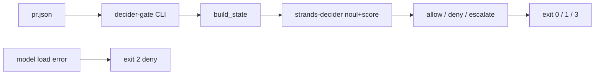

# minilab-decider-merge-gate

**Built by SkilledDragon LLC — architecture-led software engineering — [skilleddragon.com](https://skilleddragon.com)**

Palette: `#020617` / `#040F49` / `#006BDF` / `#00BFA6`

## What we built

`decider-gate` is a Python package and CLI that wraps [strands-labs/strands-decider](https://github.com/strands-labs/strands-decider) as a pre-merge gate. It reads a PR summary (`pr.json`), asks the System-1 decider a yes/no noul question plus a calibrated score, and returns `{decision: allow|deny|escalate, confidence, reasons}`. Exit codes: `0` allow, `1` deny, `2` model-load failure (fail closed), `3` escalate when confidence is below the threshold. That matches the spirit of a cheap local first “no” before expensive LLM review — según Anthropic’s redesign of source control for agentic coding ([engineering note](https://www.anthropic.com/engineering/redesigning-source-control)); Scion is Anthropic-internal and not for general use.

## What we tested

| Suite | Command | Notes |
| --- | --- | --- |
| Lab unit + schema + CLI | `HF_HUB_OFFLINE=1 uv run pytest -q` | Fake decider; live marker excluded |
| Lab lint | `uv run ruff check .` and `uv run ruff format --check .` | |
| Skills layout | `python3 scripts/check-skills` | `.claude/skills` only |
| Banned phrases | `python3 scripts/check-banned-phrases` | Lab-authored files |
| Upstream pin | `python3 scripts/check-upstream-pin` | Must print `8b6faa553038a59e73fa7f16c4081f8ceb21d27e` |
| Upstream parity | `python3 scripts/check-upstream-parity` | Regenerates `scripts/upstream-test.sh` |
| Upstream local leg | `bash scripts/upstream-test.sh` | cpu py3.10 row + lint from `ci/upstream/tests.yml` |
| Upstream CI | `.github/workflows/upstream-ci.yml` | Verbatim upstream jobs with A1–A2 only |

See [RESULTS.md](RESULTS.md) for pass counts, durations, and the CI run URL.

## Setup

```bash
git clone --recurse-submodules https://github.com/SkilledDragonCorp/minilab-decider-merge-gate.git
cd minilab-decider-merge-gate
cp .env.example .env
uv sync --locked --group dev
python3 scripts/check-upstream-pin
```

Keyless unit tests use a deterministic fake decider and need only the base sync above.

To load the real model (Linux x86_64 or Apple silicon), install the `gate` dependency group — this is the pin from the Cursor prompt:

```bash
uv sync --locked --group dev --group gate
```

That resolves to `strands-decider @ git+https://github.com/strands-labs/strands-decider@8b6faa553038a59e73fa7f16c4081f8ceb21d27e` plus CPU torch from `https://download.pytorch.org/whl/cpu`.

## Tutorial

1. Validate fixtures and the fake gate:

```bash
HF_HUB_OFFLINE=1 HF_HUB_DISABLE_TELEMETRY=1 uv run pytest -q
```

Expected: all non-live tests pass.

2. Run the CLI against the unsafe fixture with the fake deny path:

```bash
uv run decider-gate --pr-json tests/fixtures/unsafe-pr.json --fake deny
echo $?
```

Expected JSON `decision` is `deny` and the shell exit code is `1`.

3. Escalate when confidence is low:

```bash
uv run decider-gate --pr-json tests/fixtures/safe-pr.json --fake escalate --threshold 0.8
echo $?
```

Expected `decision` is `escalate` and exit code `3`.

4. (Optional live) Load the real default checkpoint and refuse a clearly-unsafe PR:

```bash
HF_HUB_OFFLINE=0 HF_HUB_DISABLE_TELEMETRY=1 uv run pytest -q -m live tests/test_live.py
```

## Architecture



## Using these skills in Claude Code and Cursor

Skill path: `.claude/skills/decider-merge-gate/SKILL.md`

- **Claude Code** auto-discovers skills under `.claude/skills/<name>/SKILL.md`. Invoke by name: `decider-merge-gate`.
- **Cursor** loads the same `.claude/skills` folder. Ask the agent to follow the `decider-merge-gate` skill when gating an agent PR.

## API keys

| Variable | Required | Where | Used by |
| --- | --- | --- | --- |
| `HF_HUB_OFFLINE` | Required in CI keyless jobs (`1`) | process env / `.env` | Required pytest job; Hub downloads fail closed |
| `HF_HUB_DISABLE_TELEMETRY` | Recommended (`1`) | process env / `.env` | Hugging Face Hub client telemetry opt-out |
| `DO_NOT_TRACK` | Recommended (`1`) | process env / `.env` | Generic telemetry opt-out |
| `DISABLE_TELEMETRY` | Recommended (`1`) | process env / `.env` | Generic telemetry opt-out |
| `DECIDER_MODEL` | Optional | process env / `.env` | Checkpoint override (default `StrandsAgents/strands-decider-2B-qwen3.5-v1-2610`) |
| `DECIDER_DEVICE` | Optional | process env / `.env` | `cpu` / `mps` / `cuda` / `mlx` |
| `HF_TOKEN` | Optional | Hugging Face settings; `.env` | Live slice only when a checkpoint is gated. Default model card at the pin: **not gated**. |
| `CODECOV_TOKEN` | Optional | GitHub Actions repository secret | Verbatim Codecov steps in `upstream-ci` |

Mirror empty values live in [`.env.example`](.env.example).

## License

- This minilab: **MIT** (SkilledDragon LLC)
- Upstream `strands-labs/strands-decider` @ `8b6faa553038a59e73fa7f16c4081f8ceb21d27e`: **Apache-2.0**
